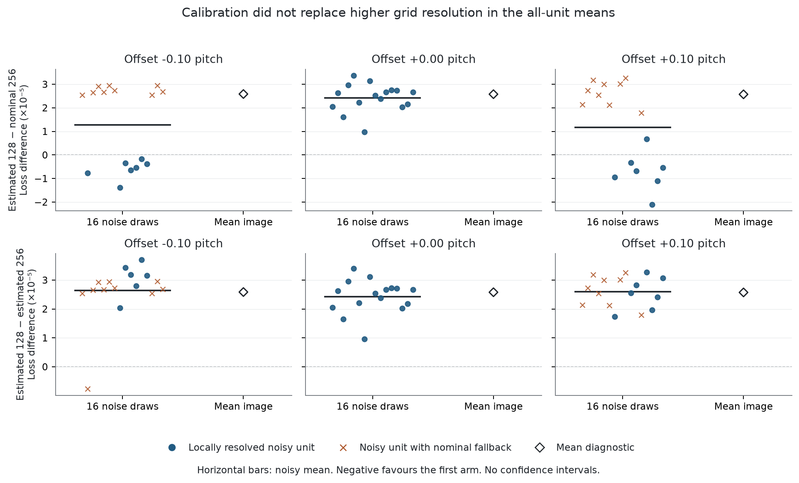
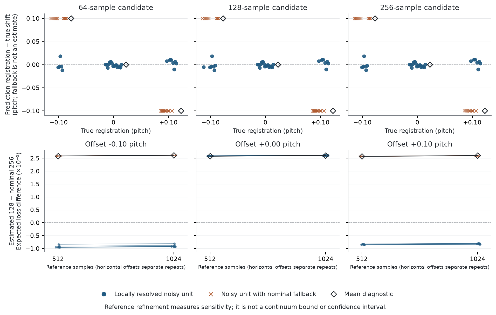
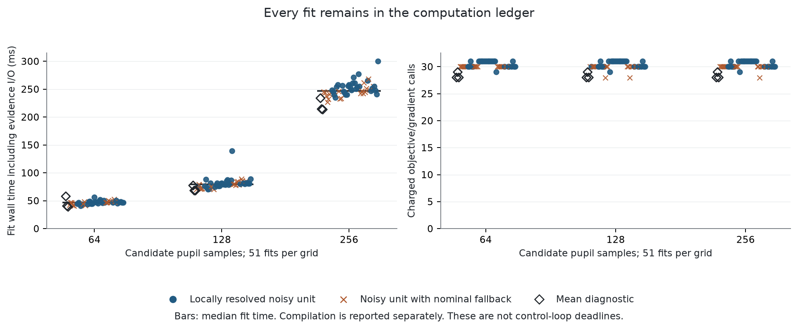

# Registration or resolution?

**Calibration improved mean predictive loss at a fixed grid in the two shifted regimes, but calibrated 128-sample predictions did not replace nominal 256-sample predictions.** Their mean predictive loss was higher in all three physical states. The estimator also returned nominal fallback for 18 of 32 shifted noisy units at 128 samples.

This is a known-flat optical simulation with three fixed mirror–pupil offsets. It measures image prediction, with no controller, hardware or held-out qualification result. The [protocol](../../docs/twin-registration.md) and all original acceptance rules remain fixed.

## Predictive loss

Each row includes all 16 noisy realizations, including fallbacks. Differences are Poisson loss per incident scoring photon; **negative favours the first arm**. Values below are multiplied by 10⁵. NLL excludes the factorial term, so percentage improvements would be arbitrary. These descriptive means have no confidence interval or superiority gate.

| True offset (pitch) | Estimated 128 − nominal 128 | Estimated 128 − nominal 256 (primary) | Estimated 128 − estimated 256 | 128-sample fallbacks |
| --- | ---: | ---: | ---: | ---: |
| −0.10 | −1.54444 | +1.27691 | +2.63721 | 9/16 |
| 0 | −0.00073 | +2.42936 | +2.43000 | 0/16 |
| +0.10 | −1.42795 | +1.17304 | +2.60141 | 9/16 |

The matched 256-sample estimator also has lower mean loss in every stratum. Within-grid calibration gains therefore do not establish a resolution-substitution advantage. At zero offset, individual noisy calibration effects have both signs; the small mean change is not evidence of a benefit.



The three deterministic expected-mean diagnostics are plotted separately. At both nonzero offsets, every grid fell back to nominal registration, so within-grid calibration changed no prediction. Estimated 128 − nominal 256 was +2.58638 × 10⁻⁵ at −0.10 pitch and +2.57333 × 10⁻⁵ at +0.10 pitch; at zero offset it was +2.57942 × 10⁻⁵.

## Coverage and numerical diagnosis

| Candidate grid | Fallbacks at −0.10 | Fallbacks at 0 | Fallbacks at +0.10 | Expected-mean fallbacks | All locally resolved fits |
| --- | ---: | ---: | ---: | ---: | ---: |
| 64 | 11/16 | 0/16 | 9/16 | 2/3 | 29/51 |
| 128 | 9/16 | 0/16 | 9/16 | 2/3 | 31/51 |
| 256 | 10/16 | 0/16 | 9/16 | 2/3 | 30/51 |

All 765 starts satisfied the declared stationarity rule. All 63 unresolved fits failed the separate near-best endpoint-spread criterion; none exhausted its call allowance or stopped with an unconfirmed stationary point. In the shifted expected-mean diagnostics, endpoint spreads were approximately 1.125–1.130 × 10⁻⁴ pitch, exceeding the unchanged 10⁻⁴ criterion.

These are numerical disagreement outcomes. They do not establish physical nonidentifiability. The next numerical question is whether stationarity and endpoint agreement can be made consistent within the existing call budget. The present study retains every fallback and its loss.



Reference sensitivity compares identical predictions against 512- and 1024-sample expected images. Its labels are descriptive. Agreement supplies neither a continuum error bound nor a confidence interval; a fallback prediction of zero registration is not an estimated zero shift. The true-registration arm is evaluator-only and can retain finite-grid bias.

## Computation and acquisition

Each unit uses eight labelled calibration images with four million incident photons and four scoring images with two million photons. Calibration actuators are 12 and 7; scoring uses unseen actuator 18. The candidate grids share the same observations. All 153 fits and 306 nominal/estimated prediction blocks were frozen before scoring or evaluator-only predictions.

| Grid | Objective/gradient calls, all 51 fits | Median fit time (ms) | Total fit time (s) | Objective / prediction compilation (s) |
| --- | ---: | ---: | ---: | ---: |
| 64 | 1,541 | 46.924 | 2.383 | 0.255 / 0.136 |
| 128 | 1,537 | 79.676 | 4.079 | 0.175 / 0.134 |
| 256 | 1,539 | 246.992 | 12.666 | 0.176 / 0.137 |



The complete acquisition took 40.740 s on an Apple M5 Pro CPU, using a measured peak process-group RSS of 1.704 GB. It retained 72 reference images, 459 prediction blocks and 4,617 charged objective/gradient calls. Fit timings include evidence I/O; compilation is separate. These component measurements do not establish a control-loop deadline or an equal-resource controller comparison.

## Evidence and reproduction

Acquisition source identifier: `809196f645cb606524648c926947424d53b04edc`. Its exact scientific source files are included in this snapshot; see the [source mapping](../../docs/source-provenance.md). The fixed environment used Python 3.11.15, NumPy 2.4.6, SciPy 1.17.1, HCIPy 0.7.0, dLux 0.15.1 and JAX/JAXlib 0.10.2, CPU float64 and one numerical worker.

A separate retained-data audit verified the complete 790-file inventory, solver traces, nominal fallbacks, observation seeds, global prediction barrier, 1,377 losses and 408 paired contrasts. Reported reductions reproduced exactly. An independent compensated sum of the same rounded terms stayed within its prospectively fixed arithmetic bound. This audit does not independently recompute optical propagation, gradients or logarithms.

- [Complete per-unit derived evidence](summary.json): all 51 units, eight contrasts, fit endpoints, costs and stratified summaries.
- [Source and audit provenance](provenance.json), including the raw-manifest digest. The 131 MB raw NPZ/JSON acquisition and its full manifest are retained separately; this compact report does not provide a raw download.
- [Figure source](../../scripts/plot_registration_development.py): regenerates all figures from the included summary.

Use a fresh isolated environment for this repository. The separate `noether-ao` repository currently uses the same Python distribution and import names, so keep the two environments separate. Generate a fresh study packet with the frozen source and compatible pinned environment:

```bash
uv run --no-sync python scripts/run_registration.py NEW_OUTPUT_ROOT --min-free-gib 4
python scripts/plot_registration_development.py
```

The included launcher applies sampled resource supervision; see the [reproduction instructions](../../README.md#reproduce-the-study) for its limits and backing-filesystem reserve. Fresh executions retain their own timing and artifact identities. Known-flat illumination, fixed flux/gain/diversity, three physical states and 16 noise realizations per state limit interpretation. Incoming aberrations, instrument calibration drift and closed-loop consequences require separate evidence. No selection/evaluation promotion is made.

## Citation

```bibtex
@misc{noetherlabs2026registration,
  title = {Registration or resolution? A fixed-budget optical calibration study},
  author = {{Noether Labs}},
  year = {2026},
  url = {https://github.com/noetherlabs/noether-twin/tree/main/results/registration_development_v1}
}
```
